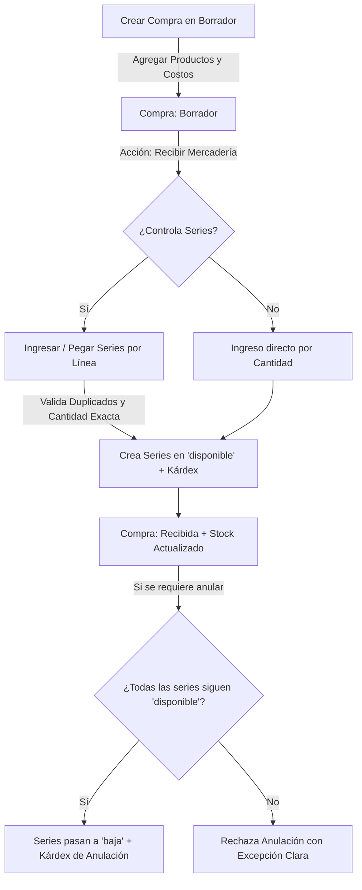
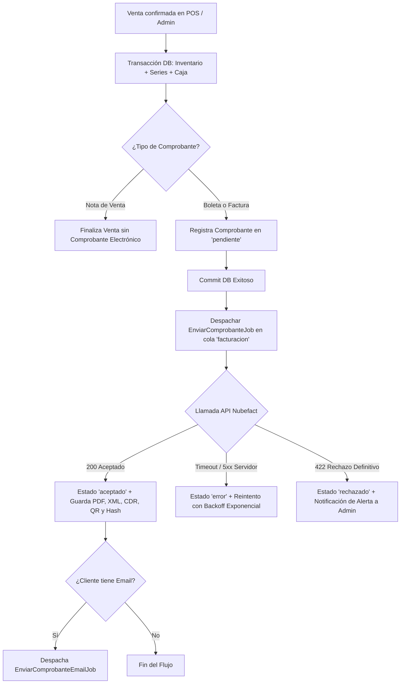

# Tienda - Sistema de Gestión de Inventario y Series

Sistema backend desarrollado con **Laravel 11**, **PostgreSQL** y panel administrativo con **Filament 3**, enfocado en la trazabilidad estricta de inventario con números de serie individuales, control de compras, kárdex inmutable y API REST autenticada mediante **Laravel Sanctum**.

---

## 🚀 Módulos de Fase 1

### 1. Catálogo de Productos
- **Categorías y Marcas**: Gestión con slug único generado automáticamente, control de estado (activo/inactivo) y prevención de eliminación física cuando poseen productos vinculados.
- **Productos**: 
  - SKU y slug únicos.
  - Precio de venta con margen y control de IGV (18%).
  - Configuración de `controla_series`: determina si el producto requiere ingreso unitario de series o acumulación por lote.
  - Alerta visual de stock bajo cuando `stock_disponible <= stock_minimo`.
  - Especificaciones técnicas en formato `JSONB`.
  - Auditoría completa con `spatie/laravel-activitylog`.

### 2. Compras y Proveedores
- **Proveedores**: Validación estricta de documentos peruanos (RUC de 11 dígitos, DNI de 8 dígitos) y bloqueo de eliminación si existen compras asociadas.
- **Gestión de Compras**:
  - Código correlativo seguro ante concurrencia con formato `COM-000001`.
  - Estados del comprobante: `Borrador`, `Recibida` y `Anulada`.
  - Cálculo automático y en tiempo real de Subtotal, IGV (18%) y Total.

### 3. Trazabilidad de Series y Kárdex Inmutable
- **Ciclo de Vida de Series (`EstadoSerie`)**:
  - Transiciones válidas y centralizadas: `disponible`, `reservada`, `vendida`, `en_garantia`, `devuelta` y `baja`.
  - Historial y línea de tiempo por serie.
  - Ajustes de estado manuales restringidos exclusivamente a administradores.
- **Movimientos de Inventario (`movimientos_inventario`)**:
  - Kárdex transaccional e inmutable (operaciones de edición y eliminación bloqueadas a nivel de modelo).
  - Tipos: `ingreso`, `salida`, `ajuste`, `anulacion`.
  - Registro de `stock_resultante` tras cada movimiento.

### 4. Seguridad y Roles
- Configurado con `spatie/laravel-permission` y Policies de Laravel:
  - **Admin**: Acceso completo a Filament, anulación de compras, ajuste de estados de series y visibilidad de costos (`costos.ver`).
  - **Almacén**: Gestión de catálogo, recepción de compras e inventario físico; costos y márgenes ocultos, sin permisos de anulación.
  - **Vendedor**: Acceso restringido fuera del panel administrativo de Filament (listo para integración POS en Fase 2).

---

## 🔄 Flujo: Compra ➔ Recepción ➔ Stock ➔ Anulación



1. **Crear Borrador**: El usuario registra los datos del comprobante y el detalle de productos.
2. **Recepción Atómica**: En una única transacción de base de datos:
   - Se valida que la cantidad de series coincida exactamente con la cantidad facturada.
   - Se verifica que no existan duplicados dentro del lote ni en la base de datos.
   - Las series se normalizan (`trim` + `MAYÚSCULAS`).
   - Se genera una serie en estado `disponible` y un movimiento de kárdex con su `stock_resultante`.
3. **Anulación Segura**:
   - Una compra recibida solo puede anularse si **todas** sus series continúan en estado `disponible`. Si alguna unidad fue vendida o transferida, el sistema rechaza la operación.
   - Al anular, las series pasan a `baja` y se descuentan del stock mediante movimientos de tipo `anulacion`.

---

## 📦 Instalación y Configuración

### 1. Variables de Entorno (`.env`)
Configurar la conexión a PostgreSQL y zona horaria:
```env
APP_TIMEZONE=America/Lima
APP_LOCALE=es

DB_CONNECTION=pgsql
DB_HOST=127.0.0.1
DB_PORT=5432
DB_DATABASE=tienda
DB_USERNAME=postgres
DB_PASSWORD=root
```

### 2. Migraciones y Seeders Base
```powershell
php artisan migrate:fresh --seed
```
*Crea los roles (`admin`, `almacen`, `vendedor`), permisos del sistema y las cuentas iniciales.*

### 3. Cargar Datos de Demostración (Opcional)
Para poblar el catálogo con 5 categorías, 6 marcas, 15 productos técnicos, 3 proveedores y 2 compras recibidas con series reales:
```powershell
php artisan db:seed --class=CatalogoDemoSeeder
```

---

## 🔑 Credenciales de Acceso al Panel

Acceso: `http://localhost:8000/admin`

| Rol | Correo | Contraseña | Capacidades |
|---|---|---|---|
| **Administrador** | `admin@tienda.com` | `password` | Control total, anulación de compras, ajustes y costos visibles |
| **Almacenero** | `almacen@tienda.com` | `password` | Catálogo, recepción de compras y kárdex (costos ocultos) |
| **Vendedor** | `vendedor@tienda.com` | `password` | Acceso a API / POS (panel admin bloqueado) |

---

## 🌐 Endpoints de la API REST (v1)

Todas las rutas requieren autenticación con token Bearer (`auth:sanctum`).

### 1. Listar Productos
- **`GET /api/v1/productos`**
- **Parámetros query opcionales**:
  - `categoria_id`: Filtrar por ID de categoría.
  - `marca_id`: Filtrar por ID de marca.
  - `buscar`: Búsqueda por SKU, nombre o modelo.
  - `per_page`: Cantidad de resultados por página (default 15).
- **Respuesta**: Paginada con `stock_disponible` calculado en tiempo real. Oculta `precio_compra_referencial` si el usuario no tiene rol `admin`.

### 2. Consultar Producto por ID
- **`GET /api/v1/productos/{id}`**

### 3. Consultar Serie y Trazabilidad
- **`GET /api/v1/series/{numero}`**
- Retorna el estado actual de la serie, producto asociado y comprobante de compra de origen. Oculta el campo `costo` a usuarios sin rol de administración.

---

## 🛍️ Módulos de Fase 2: POS, Caja y Facturación Electrónica

### 1. Punto de Venta (POS) en `/pos`
- **Interfaz moderna a pantalla completa**: Desarrollada en **Livewire 3 + Tailwind CSS**, optimizada para táctil, lectores de código de barras y teclado numérico.
- **Flujo de Caja Turno por Turno**:
  - Restricción estricta: un vendedor no puede cobrar sin una sesión de caja abierta.
  - Modales para **apertura de caja**, **ingresos/egresos manuales**, y **cierre ciego** con cálculo automático de diferencia (sobrante/faltante).
- **Proceso de Cobro Rápido**:
  - Búsqueda en tiempo real por nombre, SKU o escaneo directo de número de serie.
  - Pagos mixtos (Efectivo, Yape, Plin, Tarjeta POS, Transferencia bancaria) con cálculo inmediato de vuelto.
  - Generación e impresión de ticket térmico estándar de 80 mm (`/pos/ticket/{id}`) con QR de SUNAT, hash SHA y desglose de formas de pago.

### 2. Facturación Electrónica Asíncrona con Nubefact
- **Principio Fundamental**: **La venta nunca depende de internet ni de SUNAT**.
  1. La venta se registra localmente garantizando serie y correlativo sin saltos (`lockForUpdate`).
  2. Inmediatamente después del commit (`afterCommit`), se inicializa el comprobante en estado `pendiente` y se despacha un Job a la cola `facturacion`.
  3. Si SUNAT o Nubefact tienen intermitencia, la venta queda intacta y el sistema reintenta el envío en segundo plano.
- **Arquitectura de Emisión Desacoplada**:
  - Interfaz `App\Services\Facturacion\EmisorComprobante` (`emitir`, `consultar`, `anular`).
  - Implementación `NubefactEmisor`: Cliente HTTP con timeout, reintentos y clasificación de errores.
  - Implementación `EmisorSimulado`: Respuestas inmediatas y realistas para pruebas y desarrollo offline.
  - Vinculación automática en el contenedor de servicios según `NUBEFACT_MODO`.

---

## 🔄 Flujo: Venta ➔ Comprobante ➔ SUNAT



---

## ⚙️ Configuración de Facturación y Entornos

En `.env`:
```env
# Modos disponibles: 'simulado', 'demo', 'produccion'
NUBEFACT_MODO=simulado

# Credenciales de API Nubefact (solo para demo o produccion)
NUBEFACT_RUTA=https://api.nubefact.com/api/v1/xxxxxxxx-xxxx-xxxx-xxxx-xxxxxxxxxxxx
NUBEFACT_TOKEN=xxxxxxxxxxxxxxxxxxxxxxxxxxxxxxxxxxxxxxxxxxxxxxxxxxxxxxxxxxxxxxxx

# Parámetros de conexión HTTP
NUBEFACT_TIMEOUT=15
NUBEFACT_RETRIES=2
```

### Cómo pasar de Demo a Producción:
1. En tu cuenta de **Nubefact**, obtén la URL y Token de producción en **API - Integración**.
2. Cambia en el archivo `.env`:
   ```env
   NUBEFACT_MODO=produccion
   NUBEFACT_RUTA=https://api.nubefact.com/api/v1/tu-ruta-de-produccion
   NUBEFACT_TOKEN=tu-token-real-de-produccion
   ```
3. Ejecuta `php artisan config:cache` para actualizar la configuración.
4. En el panel Filament, ingresa a **Facturación Electrónica > Estado de Integración** y pulsa **Probar Conexión con Nubefact** para validar la autenticación antes de emitir comprobantes reales.

---

## 🔄 Colas, Scheduler y Supervisor

### 1. Ejecución Local de Trabajadores de Cola
Para procesar comprobantes en desarrollo:
```powershell
php artisan queue:work --queue=facturacion,default --tries=5
```

### 2. Ejecución Local del Scheduler
Para ejecutar el scheduler de reintento automático (cada 10 minutos):
```powershell
php artisan schedule:work
```

### 3. Configuración con Supervisor en Servidor de Producción (Linux)
Crea el archivo `/etc/supervisor/conf.d/tienda-worker.conf`:
```ini
[program:tienda-worker]
process_name=%(program_name)s_%(process_num)02d
command=php /var/www/tienda/artisan queue:work --queue=facturacion,default --sleep=3 --tries=5 --max-time=3600
autostart=true
autorestart=true
stopasgroup=true
killasgroup=true
user=www-data
numprocs=2
redirect_stderr=true
stdout_logfile=/var/www/tienda/storage/logs/worker.log
stopwaitsecs=3600
```

Actualiza e inicia el servicio:
```bash
sudo supervisorctl reread
sudo supervisorctl update
sudo supervisorctl start tienda-worker:*
```

Y agrega la tarea programada en el crontab del servidor (`crontab -e -u www-data`):
```cron
* * * * * cd /var/www/tienda && php artisan schedule:run >> /dev/null 2>&1
```

---

## 🧪 Pruebas Automatizadas y Calidad

Ejecutar la suite completa de pruebas (66 tests de Fase 0, Fase 1 y Fase 2):
```powershell
php artisan test
```

Verificar estándar de código PSR-12:
```powershell
./vendor/bin/pint --test
```

Ejecutar análisis estático con Larastan / PHPStan (Nivel 5):
```powershell
./vendor/bin/phpstan analyse --memory-limit=1G
```
