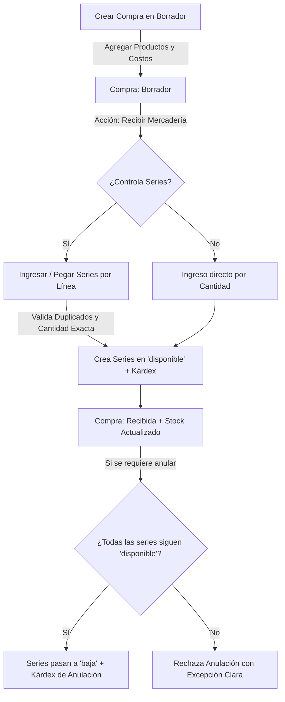
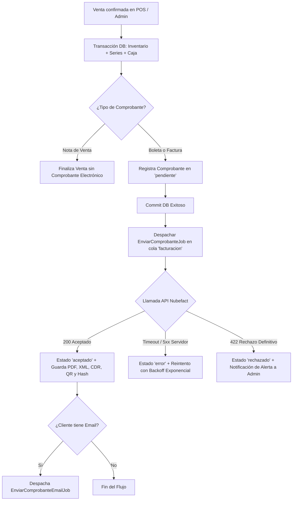
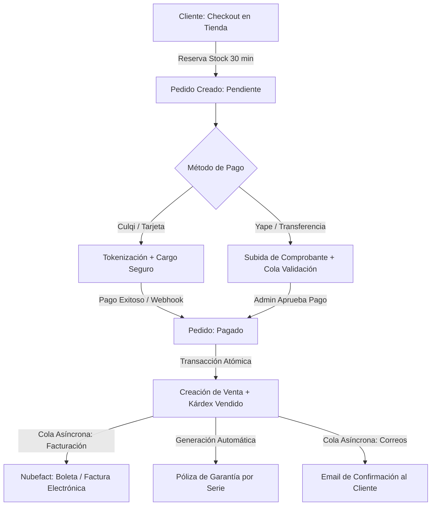

# Tienda - Sistema de Gestión de Inventario y Series

Sistema backend desarrollado con **Laravel 11**, **PostgreSQL** y panel administrativo con **Filament 3**, enfocado en la trazabilidad estricta de inventario con números de serie individuales, control de compras, kárdex inmutable y API REST autenticada mediante **Laravel Sanctum**.

---

## 🚀 Módulos de Fase 1

### 1. Catálogo de Productos
- **Categorías y Marcas**: Gestión con slug único generado automáticamente, control de estado (activo/inactivo) y prevención de eliminación física cuando poseen productos vinculados.
- **Productos**: 
  - SKU y slug únicos.
  - Precio de venta con margen y control de IGV (18%).
  - Configuración de `controla_series`: determina si el producto requiere ingreso unitario de series o acumulación por lote.
  - Alerta visual de stock bajo cuando `stock_disponible <= stock_minimo`.
  - Especificaciones técnicas en formato `JSONB`.
  - Auditoría completa con `spatie/laravel-activitylog`.

### 2. Compras y Proveedores
- **Proveedores**: Validación estricta de documentos peruanos (RUC de 11 dígitos, DNI de 8 dígitos) y bloqueo de eliminación si existen compras asociadas.
- **Gestión de Compras**:
  - Código correlativo seguro ante concurrencia con formato `COM-000001`.
  - Estados del comprobante: `Borrador`, `Recibida` y `Anulada`.
  - Cálculo automático y en tiempo real de Subtotal, IGV (18%) y Total.

### 3. Trazabilidad de Series y Kárdex Inmutable
- **Ciclo de Vida de Series (`EstadoSerie`)**:
  - Transiciones válidas y centralizadas: `disponible`, `reservada`, `vendida`, `en_garantia`, `devuelta` y `baja`.
  - Historial y línea de tiempo por serie.
  - Ajustes de estado manuales restringidos exclusivamente a administradores.
- **Movimientos de Inventario (`movimientos_inventario`)**:
  - Kárdex transaccional e inmutable (operaciones de edición y eliminación bloqueadas a nivel de modelo).
  - Tipos: `ingreso`, `salida`, `ajuste`, `anulacion`.
  - Registro de `stock_resultante` tras cada movimiento.

### 4. Seguridad y Roles
- Configurado con `spatie/laravel-permission` y Policies de Laravel:
  - **Admin**: Acceso completo a Filament, anulación de compras, ajuste de estados de series y visibilidad de costos (`costos.ver`).
  - **Almacén**: Gestión de catálogo, recepción de compras e inventario físico; costos y márgenes ocultos, sin permisos de anulación.
  - **Vendedor**: Acceso restringido fuera del panel administrativo de Filament (listo para integración POS en Fase 2).

---

## 🔄 Flujo: Compra ➔ Recepción ➔ Stock ➔ Anulación



1. **Crear Borrador**: El usuario registra los datos del comprobante y el detalle de productos.
2. **Recepción Atómica**: En una única transacción de base de datos:
   - Se valida que la cantidad de series coincida exactamente con la cantidad facturada.
   - Se verifica que no existan duplicados dentro del lote ni en la base de datos.
   - Las series se normalizan (`trim` + `MAYÚSCULAS`).
   - Se genera una serie en estado `disponible` y un movimiento de kárdex con su `stock_resultante`.
3. **Anulación Segura**:
   - Una compra recibida solo puede anularse si **todas** sus series continúan en estado `disponible`. Si alguna unidad fue vendida o transferida, el sistema rechaza la operación.
   - Al anular, las series pasan a `baja` y se descuentan del stock mediante movimientos de tipo `anulacion`.

---

## 📦 Instalación y Configuración

### 1. Variables de Entorno (`.env`)
Configurar la conexión a PostgreSQL y zona horaria:
```env
APP_TIMEZONE=America/Lima
APP_LOCALE=es

DB_CONNECTION=pgsql
DB_HOST=127.0.0.1
DB_PORT=5432
DB_DATABASE=tienda
DB_USERNAME=postgres
DB_PASSWORD=root
```

### 2. Migraciones y Seeders Base
```powershell
php artisan migrate:fresh --seed
```
*Crea los roles (`admin`, `almacen`, `vendedor`), permisos del sistema y las cuentas iniciales.*

### 3. Cargar Datos de Demostración (Opcional)
Para poblar el catálogo con 5 categorías, 6 marcas, 15 productos técnicos, 3 proveedores y 2 compras recibidas con series reales:
```powershell
php artisan db:seed --class=CatalogoDemoSeeder
```

---

## 🔑 Credenciales de Acceso al Panel

Acceso: `http://localhost:8000/admin`

| Rol | Correo | Contraseña | Capacidades |
|---|---|---|---|
| **Administrador** | `admin@tienda.com` | `password` | Control total, anulación de compras, ajustes y costos visibles |
| **Almacenero** | `almacen@tienda.com` | `password` | Catálogo, recepción de compras y kárdex (costos ocultos) |
| **Vendedor** | `vendedor@tienda.com` | `password` | Acceso a API / POS (panel admin bloqueado) |

---

## 🌐 Endpoints de la API REST (v1)

Todas las rutas requieren autenticación con token Bearer (`auth:sanctum`).

### 1. Listar Productos
- **`GET /api/v1/productos`**
- **Parámetros query opcionales**:
  - `categoria_id`: Filtrar por ID de categoría.
  - `marca_id`: Filtrar por ID de marca.
  - `buscar`: Búsqueda por SKU, nombre o modelo.
  - `per_page`: Cantidad de resultados por página (default 15).
- **Respuesta**: Paginada con `stock_disponible` calculado en tiempo real. Oculta `precio_compra_referencial` si el usuario no tiene rol `admin`.

### 2. Consultar Producto por ID
- **`GET /api/v1/productos/{id}`**

### 3. Consultar Serie y Trazabilidad
- **`GET /api/v1/series/{numero}`**
- Retorna el estado actual de la serie, producto asociado y comprobante de compra de origen. Oculta el campo `costo` a usuarios sin rol de administración.

---

## 🛍️ Módulos de Fase 2: POS, Caja y Facturación Electrónica

### 1. Punto de Venta (POS) en `/pos`
- **Interfaz moderna a pantalla completa**: Desarrollada en **Livewire 3 + Tailwind CSS**, optimizada para táctil, lectores de código de barras y teclado numérico.
- **Flujo de Caja Turno por Turno**:
  - Restricción estricta: un vendedor no puede cobrar sin una sesión de caja abierta.
  - Modales para **apertura de caja**, **ingresos/egresos manuales**, y **cierre ciego** con cálculo automático de diferencia (sobrante/faltante).
- **Proceso de Cobro Rápido**:
  - Búsqueda en tiempo real por nombre, SKU o escaneo directo de número de serie.
  - Pagos mixtos (Efectivo, Yape, Plin, Tarjeta POS, Transferencia bancaria) con cálculo inmediato de vuelto.
  - Generación e impresión de ticket térmico estándar de 80 mm (`/pos/ticket/{id}`) con QR de SUNAT, hash SHA y desglose de formas de pago.

### 2. Facturación Electrónica Asíncrona con Nubefact
- **Principio Fundamental**: **La venta nunca depende de internet ni de SUNAT**.
  1. La venta se registra localmente garantizando serie y correlativo sin saltos (`lockForUpdate`).
  2. Inmediatamente después del commit (`afterCommit`), se inicializa el comprobante en estado `pendiente` y se despacha un Job a la cola `facturacion`.
  3. Si SUNAT o Nubefact tienen intermitencia, la venta queda intacta y el sistema reintenta el envío en segundo plano.
- **Arquitectura de Emisión Desacoplada**:
  - Interfaz `App\Services\Facturacion\EmisorComprobante` (`emitir`, `consultar`, `anular`).
  - Implementación `NubefactEmisor`: Cliente HTTP con timeout, reintentos y clasificación de errores.
  - Implementación `EmisorSimulado`: Respuestas inmediatas y realistas para pruebas y desarrollo offline.
  - Vinculación automática en el contenedor de servicios según `NUBEFACT_MODO`.

---

## 🔄 Flujo: Venta ➔ Comprobante ➔ SUNAT



---

## ⚙️ Configuración de Facturación y Entornos

En `.env`:
```env
# Modos disponibles: 'simulado', 'demo', 'produccion'
NUBEFACT_MODO=simulado

# Credenciales de API Nubefact (solo para demo o produccion)
NUBEFACT_RUTA=https://api.nubefact.com/api/v1/xxxxxxxx-xxxx-xxxx-xxxx-xxxxxxxxxxxx
NUBEFACT_TOKEN=xxxxxxxxxxxxxxxxxxxxxxxxxxxxxxxxxxxxxxxxxxxxxxxxxxxxxxxxxxxxxxxx

# Parámetros de conexión HTTP
NUBEFACT_TIMEOUT=15
NUBEFACT_RETRIES=2
```

### Cómo pasar de Demo a Producción:
1. En tu cuenta de **Nubefact**, obtén la URL y Token de producción en **API - Integración**.
2. Cambia en el archivo `.env`:
   ```env
   NUBEFACT_MODO=produccion
   NUBEFACT_RUTA=https://api.nubefact.com/api/v1/tu-ruta-de-produccion
   NUBEFACT_TOKEN=tu-token-real-de-produccion
   ```
3. Ejecuta `php artisan config:cache` para actualizar la configuración.
4. En el panel Filament, ingresa a **Facturación Electrónica > Estado de Integración** y pulsa **Probar Conexión con Nubefact** para validar la autenticación antes de emitir comprobantes reales.

---

## 🔄 Colas, Scheduler y Supervisor

### 1. Ejecución Local de Trabajadores de Cola
Para procesar comprobantes en desarrollo:
```powershell
php artisan queue:work --queue=facturacion,default --tries=5
```

### 2. Ejecución Local del Scheduler
Para ejecutar el scheduler de reintento automático (cada 10 minutos):
```powershell
php artisan schedule:work
```

### 3. Configuración con Supervisor en Servidor de Producción (Linux)
Crea el archivo `/etc/supervisor/conf.d/tienda-worker.conf`:
```ini
[program:tienda-worker]
process_name=%(program_name)s_%(process_num)02d
command=php /var/www/tienda/artisan queue:work --queue=facturacion,default --sleep=3 --tries=5 --max-time=3600
autostart=true
autorestart=true
stopasgroup=true
killasgroup=true
user=www-data
numprocs=2
redirect_stderr=true
stdout_logfile=/var/www/tienda/storage/logs/worker.log
stopwaitsecs=3600
```

Actualiza e inicia el servicio:
```bash
sudo supervisorctl reread
sudo supervisorctl update
sudo supervisorctl start tienda-worker:*
```

Y agrega la tarea programada en el crontab del servidor (`crontab -e -u www-data`):
```cron
* * * * * cd /var/www/tienda && php artisan schedule:run >> /dev/null 2>&1
```

---

## 🛡️ Módulos de Fase 3: Garantías, Devoluciones y Servicio Técnico

### 1. Sistema de Garantías
- **Jerarquía y Snapshot de Condiciones**:
  1. *Específica de Producto* (si está configurada).
  2. *Por Categoría*.
  3. *General de la Tienda* (fallback por defecto: 12 meses y 7 días calendario para cambio directo).
  - Al emitirse la venta, las condiciones exactas se congelan en un snapshot inmutable dentro del registro de la garantía (`condiciones_snapshot`).
- **Estados de Garantía (`EstadoGarantia`)**: `vigente`, `por_vencer` (<= 30 días), `vencida`, `anulada`.
- **Tarea Programada / Comando**:
  ```powershell
  php artisan garantias:marcar-vencidas
  ```
- **Consulta en POS y Filament**: Buscador por número de serie con cálculo en tiempo real de días restantes y accesos directos para *Iniciar Devolución / Cambio* o *Recibir en Servicio Técnico*.

### 2. Devoluciones, Cambios y Notas de Crédito
- **Tipos de Devolución (`TipoDevolucion`)**:
  - `devolucion_dinero`: Reembolso al cliente generando un egreso automático en la caja abierta del usuario.
  - `cambio_producto`: Canje por otra serie disponible del mismo modelo u otro producto, liquidando diferencias monetarias a cobrar o devolver. La serie original pasa al destino configurado (`disponible`, `en_garantia` o `baja`) y la nueva se marca como `vendida` con su propia póliza de garantía.
  - `nota_credito`: Emisión electrónica vinculada a boleta o factura previa, enviada a SUNAT mediante el pipeline tolerante a fallos de Nubefact.
- **Flujo de Aprobación**:
  - Vendedor: Registra y envía la solicitud en el POS (`solicitada`).
  - Administrador: Aprueba (`aprobada`), rechaza con motivo obligatorio (`rechazada`) o completa la devolución (`completada`).
- **Documentos Imprimibles**:
  - Constancia de devolución/cambio en formato A4 y Ticket térmico 80 mm con firma de conformidad.

### 3. Servicio Técnico Postventa
- **Órdenes de Servicio (`ordenes_servicio`)**:
  - Código único correlativo `OS-000001`.
  - Tipos: `garantia` (costo S/ 0.00 para el cliente, asumido por la empresa) o `pago` (cotización, aprobación y cobro en POS).
  - Máquina de estados: `recibido` ➔ `diagnostico` ➔ `esperando_aprobacion` ➔ `esperando_repuesto` ➔ `en_reparacion` ➔ `reparado` ➔ `entregado` (o `sin_solucion` / `cancelado`).
- **Tablero Kanban en Filament**: Vista interactiva por columnas de estado con actualización mediante `OrdenServicioService::cambiarEstado`.
- **Gestión de Repuestos y Kárdex**: Salidas automáticas de inventario con motivo `servicio_tecnico`, costeadas en la orden.
- **Notificaciones Automáticas**: Envío de correo electrónico en segundo plano al marcar la orden como reparada (`NotificarOrdenReparadaEmailJob`).
- **Documentos Imprimibles**:
  - Orden de Ingreso A4 con código QR y cláusulas de servicio.
  - Cotización formal para órdenes de pago.
  - Acta de entrega con certificado de garantía sobre la reparación efectuada.

### 4. Consulta Pública de Garantía (`/garantia`)
- Ruta web pública de autoconsulta sin necesidad de iniciar sesión.
- **Seguridad**:
  - Requiere obligatoriamente **Número de Serie + DNI/RUC** del comprador.
  - Rate limiting estricto (`throttle:5,1`, 5 peticiones por minuto por IP).
  - Protección anti-bot con campo señuelo (*honeypot*).
  - Respuestas genéricas ante discordancia para evitar enumeración de datos.
  - Estricta reserva de datos personales y costos: solo muestra producto, vigencia de garantía y avance del servicio técnico.
- Acceso rápido vía enlace y código QR impreso en el ticket de venta del POS.

### 5. API REST v1 (Sanctum)
Endpoints disponibles para integraciones externas y aplicaciones cliente:

| Método | Endpoint | Descripción | Restricciones de Costo |
|---|---|---|---|
| `GET` | `/api/v1/productos` | Catálogo con stock disponible y filtros | Oculta `precio_compra` a no-admin |
| `GET` | `/api/v1/productos/{id}` | Detalle de producto | Oculta `precio_compra` a no-admin |
| `GET` | `/api/v1/series/{numero}` | Consulta de estado de serie física | Información operativa sin costos |
| `GET` | `/api/v1/garantias/{numero_serie}` | Estado y vigencia de garantía | Datos de cobertura |
| `GET` | `/api/v1/ordenes-servicio` | Listado con filtros de servicio técnico | Oculta costos a no-admin |
| `GET` | `/api/v1/ordenes-servicio/{codigo}` | Detalle de orden técnica | `costo_estimado` y `costo_final` solo para admin |
| `POST` | `/api/v1/devoluciones` | Registrar solicitud de devolución | Autenticado con token Sanctum |

---

## 🛒 Módulos de Fase 4: Tienda Online, Pedidos, Pagos y Producción

### 1. E-Commerce y Carrito de Compras
- **Frontend Moderno**: Construido con Blade, Tailwind CSS y Livewire 3.
  - Catálogo interactivo con filtrado dinámico por marcas, precio y categorías.
  - Carrito persistente en sesión y base de datos con sincronización automática al iniciar sesión.
  - Cupones de descuento (fijo y porcentual) con validación de vigencia, tope de usos y monto mínimo.
- **Reservas Temporales y Prevención de Sobrevigilancia**:
  - Al iniciar el checkout, el stock y las series se reservan atómicamente por 30 minutos mediante `lockForUpdate`.
  - Tarea programada en cron `pedidos:expirar` que libera las reservas si el pago no se completa.
- **Libro de Reclamaciones Virtual (`/reclamaciones`)**: Conforme al Código de Protección y Defensa del Consumidor (Indecopi), con generación de código correlativo `REC-000001` y envío de copia en PDF al consumidor.

### 2. Flujo Completo: Pedido ➔ Pago ➔ Venta ➔ Comprobante ➔ Garantía



### 3. Pasarela de Pagos Culqi y Pagos Manuales
- **Integración Culqi Oficial**:
  - Creación de cargo con token (`CulqiPasarela`).
  - Detección de timeouts con re-consulta previa a reintentos para evitar dobles cobros accidentales.
  - Soporte de reembolsos directos (`reembolsarCargo`).
  - Endpoint seguro de Webhooks: `POST /webhooks/culqi` con validación de firma HMAC-SHA256, exclusión de CSRF e idempotencia.
  - Documentación de alternativa **Niubiz** en `docs/PASARELAS.md`.
- **Yape / Transferencias**:
  - Subida de comprobante seguro (validación MIME, renombrado hash, almacenamiento protegido).
  - Alerta en panel Filament si un pago manual supera las 2 horas sin confirmación.

#### Tarjetas de Prueba Culqi (Entorno de Pruebas)
| Tarjeta | CVV | Expira | Resultado Simulado |
|---|---|---|---|
| `4111 1111 1111 1111` | `123` | Fecha futura | ✅ Pago Aprobado |
| `4000 0000 0000 0002` | `123` | Fecha futura | ❌ Tarjeta Rechazada |
| `4000 0000 0000 0003` | `123` | Fecha futura | ❌ Fondos Insuficientes |
| `4000 0000 0000 0004` | `123` | Fecha futura | ⚠️ Desafío 3D Secure |

### 4. Endurecimiento de Seguridad
- **Cabeceras HTTP de Seguridad (OWASP)**:
  - `X-Frame-Options: SAMEORIGIN`
  - `X-Content-Type-Options: nosniff`
  - `Referrer-Policy: strict-origin-when-cross-origin`
  - `Content-Security-Policy`: compatible con Culqi Checkout SDK, Niubiz y Google Fonts.
- **Protección de Datos Personales (Ley N° 29733 - Perú)**:
  - Checkbox de consentimiento explícito en registro de clientes web.
  - Anonimización estricta bajo solicitud del cliente (`ClienteWeb::anonimizarDatos()`), protegiendo la identidad personal y preservando la integridad tributaria ante SUNAT.
- **Prevención de Enumeración**: Slugs y tokens UUID para URLs públicas de pedidos y comprobantes.
- **Sanitización de Logs**: Enmascaramiento de tokens, tarjetas y contraseñas.

### 5. Operaciones, Monitoreo y Conciliación
- **Comando de Salud (`php artisan tienda:salud`)**:
  - Diagnostica conexión a PostgreSQL, espacio libre en disco (GB), estado de colas (`jobs`), estado de conexión con Nubefact y pasarela activa.
  - Expuesto también en `GET /api/v1/salud` para monitoreo automatizado con token de administrador.
- **Conciliación de Pagos (`php artisan pagos:conciliar`)**:
  - Compara pagos en estado pendiente contra los registros reales de la pasarela y concilia ventas desfasadas.
- **Documentos Operativos**:
  - [RUNBOOK.md](docs/RUNBOOK.md): Guía de contingencias ante caídas de pasarela, Nubefact, saturación de disco o colas.
  - [DESPLIEGUE.md](docs/DESPLIEGUE.md): Guía paso a paso para VPS Ubuntu con Nginx, PHP 8.3, PostgreSQL, Supervisor y Let's Encrypt.
  - [RESPALDOS.md](docs/RESPALDOS.md): Estrategia de backups automatizados y restauración verificada.
  - [PRELANZAMIENTO.md](docs/PRELANZAMIENTO.md): Checklist pre-producción.
  - [PASARELAS.md](docs/PASARELAS.md): Referencia técnica Culqi y esqueleto Niubiz.
  - [REPORTES.md](docs/REPORTES.md): Definición matemática y operativa de métricas comerciales e inventario.

---

## 📊 Módulos de Fase 5: Centro de Reportes y Analítica Avanzada

### 1. Servicios Especializados (`app/Services/Reportes/`)
- **Resumen Ejecutivo**: KPIs de ventas, margen bruto, variaciones vs periodo anterior ($\Delta\%$) y panel de alertas tempranas.
- **Rentabilidad**: Márgenes por producto, categoría, marca y vendedor con alerta de ventas bajo costo o margen crítico ($<10\%$).
- **Inventario**: Valorización monetaria, stock muerto ($>90$ días), clasificación ABC de Pareto y reposición sugerida según demanda histórica.
- **Ventas**: Comparativos anuales/mensuales, mapas de calor por hora, rendimiento POS vs Web y embudo del e-commerce.
- **Compras**: Consolidado por proveedor, historial de costo de adquisición y comparativa entre cotizaciones.
- **Postventa**: Tasa de fallas por modelo, tiempos medios de reparación y devoluciones por motivo.
- **Caja**: Detección de descuadres al cierre por vendedor, anulaciones y transacciones de dinero manual.
- **Vendedores**: Ranking comercial con comisiones activables mediante flag de configuración.

### 2. Panel Administrativo en Filament 3
- Grupo de navegación **"Reportes"** con permisos dedicados por área.
- Barra superior de filtros reactivos: atajos de fecha (`hoy`, `7_dias`, `mes`, `mes_anterior`, `anio`), canal (`todos`, `pos`, `web`) y comparativa de periodo anterior persistentes en URL.
- **Acción Rápida de Compra**: Generación directa de compras en borrador desde la tabla de sugerencias de reposición llamando a `CompraService`.
- **Exportaciones Seguras**: Descargas en CSV, Excel y PDF con registro en `activity_log` y ocultamiento automático de costos para perfiles no-admin.
- **Ajustes de Reportes**: Configuración dinámica de días de stock muerto, cobertura, umbral de margen y destinatarios del resumen semanal.
- **Widget en Dashboard**: Métricas destacadas de margen del mes, capital inmovilizado y alertas activas conectadas directamente a sus reportes.

### 3. Comandos Programados
- Resumen ejecutivo semanal por correo:
```powershell
php artisan reportes:enviar-resumen-semanal
```

---

## 🧪 Pruebas Automatizadas y Calidad

Ejecutar la suite completa de pruebas (153 tests pasando de Fases 0 a 5B):
```powershell
php artisan test
```

Verificar estándar de código PSR-12:
```powershell
./vendor/bin/pint --test
```

Ejecutar análisis estático con Larastan / PHPStan (Nivel 5):
```powershell
./vendor/bin/phpstan analyse --memory-limit=1G
```


